# ha-sky-card

[](https://www.home-assistant.io/integrations/marketplace/)
[](https://github.com/juju35/ha-sky-card/actions/workflows/hacs.yml)
[](https://github.com/juju35/ha-sky-card/actions/workflows/validate.yml)
[](https://github.com/juju35/ha-sky-card/actions/workflows/lint.yml)
[](https://github.com/juju35/ha-sky-card/releases/latest)
[](https://github.com/juju35/ha-sky-card/blob/main/LICENSE)
[](https://buymeacoffee.com/julienstep9)

<p align="center">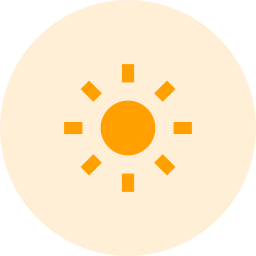</p>

<p align="center">
  &nbsp;&nbsp;
  &nbsp;&nbsp;
  &nbsp;&nbsp;
  
</p>

Animated Lovelace cards for Home Assistant showing the **sun**, the **moon** and the **season**: a sky band whose colors follow the sun's elevation with the sun's arc of the day drawn inside it, the length of the day and its change since yesterday, the moon's phase drawn as it looks tonight with its illumination and the next full or new moon, dawn and dusk, and the season with the days left until the next one.

The cards work on top of the [Sun](https://www.home-assistant.io/integrations/sun/) integration (`sun.sun`), the [Moon](https://www.home-assistant.io/integrations/moon/) and [Season](https://www.home-assistant.io/integrations/season/) integrations and, when it is installed, the [Lunar Phase](https://github.com/ngocjohn/lunar-phase) custom integration. Their entities are **discovered automatically**; whatever is missing (the moon's illumination, the next full and new moons, moonrise and moonset, the season) is **computed by the card** from your home location.

[](https://my.home-assistant.io/redirect/marketplace_repository/?owner=juju35&repository=ha-sky-card&category=plugin)

| Light | Dark |
|---|---|
| 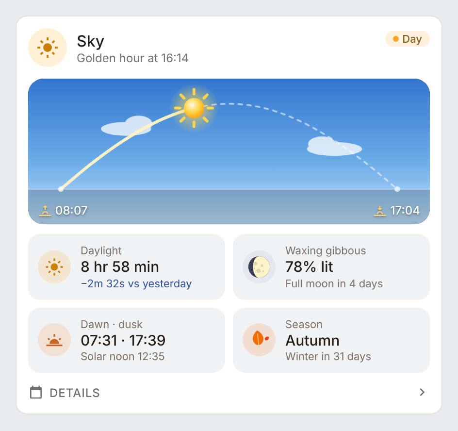 | 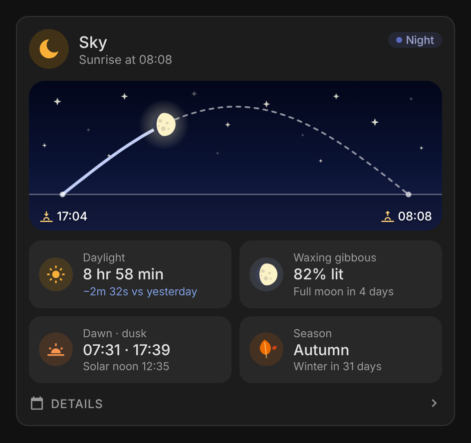 |
| 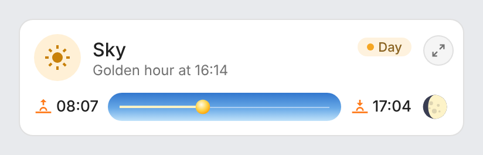 | 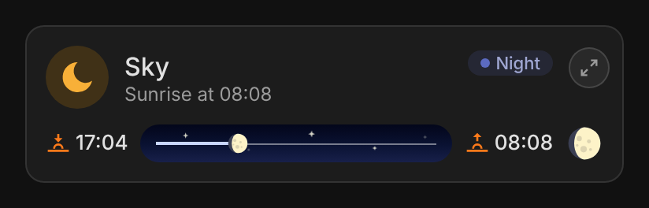 |

## Features

- Two cards: a full **Sky Card** (`custom:sky-card`) and a compact **Sky Mini Card** (`custom:sky-mini-card`)
- Header: a sun (by day) or moon (by night) badge, the **next event** as subtitle (*Golden hour at 16:14*, *Sunset at 17:04*, *Sunrise at 08:08*) and the light of the moment as a pill: **Day**, **Golden hour**, **Blue hour** or **Night**
- **Sky band** whose colors follow the sun's elevation — day blue, the warm golden hour, the blue hour, the dark night with twinkling stars — with the **sun's arc** of the day inside it: dashed from sunrise to sunset, solid up to now, the sun where it is; by night the arc runs from the sunset to the next sunrise and the **moon, drawn with its phase**, crosses it. Sunrise and sunset times sit in its bottom corners
- Four tiles: **Daylight** (length of the day and its change since yesterday), **Moon** (phase drawn as it looks, illumination, next full or new moon), **Dawn · dusk** (civil twilight, with the solar noon), **Season** (current season and days until the next one)
- **Details** section, folded by default: golden and blue hours (morning and evening), solar noon and the sun's highest elevation, current elevation and azimuth, moonrise and moonset, the moon's age, the next full and new moons, the next solstice or equinox
- Animations: the sun (or the moon) sliding along its arc to where it is, its rays and glow, drifting clouds, the shimmering horizon of the golden hour, twinkling stars and a shooting star at night, colors fading from one light to the next (see [Animations](#animations)); `animations: false` and `prefers-reduced-motion` keep it still
- Detail button on the mini card (top right): it switches the mini card to the full card's content and back; a click anywhere outside the card brings the compact view back
- Click the band or a tile to open the more-info dialog of its entity
- Visual editor in the dashboard UI for both cards (no YAML needed)
- Sections view: the full card takes 12 columns by default and at least 6, the mini card 6; narrow widths get their own layout
- Light and dark mode, English, French, German, Spanish, Italian, Dutch, European Portuguese, Polish, Serbian (Cyrillic and Latin), Romanian, Danish, Swedish, Bulgarian, Russian, Ukrainian, Hungarian, Slovak, Czech, Slovenian, Latvian and Greek
- Single file, no external dependency: every picture is drawn in SVG

## Supported integrations

| Integration | What the cards read |
|---|---|
|  [Sun](https://www.home-assistant.io/integrations/sun/) (core, `sun`) | `sun.sun`: next dawn, sunrise, solar noon, sunset and dusk, elevation, azimuth |
|  [Moon](https://www.home-assistant.io/integrations/moon/) (core, `moon`) | Moon phase (`sensor.moon_phase`) |
|  [Lunar Phase](https://github.com/ngocjohn/lunar-phase) (custom, `lunar_phase`, optional) | Phase, illumination, moon age, moonrise, moonset, next full moon, next new moon — from its phase sensor's attributes or its separate sensors |
|  [Season](https://www.home-assistant.io/integrations/season/) (core, `season`) | Current season (`sensor.season`) |

None of them is strictly required except a home location: see [Computed by the card](#computed-by-the-card).

## Prerequisites

Home Assistant 2024.8 or later. The Sun integration is set up by default with the home location; add the Moon and Season integrations (**Settings → Devices & services → Add integration**) for their sensors, and Lunar Phase if you want its values.

## Installation

### Via the Marketplace (recommended)

Click the button below to add the repository directly:

[](https://my.home-assistant.io/redirect/marketplace_repository/?owner=juju35&repository=ha-sky-card&category=plugin)

Then click **Install**, and reload your browser when the Marketplace asks you to.

Or manually:

1. Open **Settings → Marketplace → Add from link** (top right; this needs a GitHub account connected)
2. Add `https://github.com/juju35/ha-sky-card` — Type: **Dashboard**
3. Open **Sky Card** and click **Install**
4. Clear your browser cache and refresh

The Marketplace adds the resource `/local/community/ha-sky-card/sky-card.js` for you.

### Manual

1. Download `sky-card.js` and the `sky-card.i18n.*.js` translation files from the [latest release](https://github.com/juju35/ha-sky-card/releases/latest)
2. Copy them all to `/config/www/` (without the translation files, the cards show in English)
3. Go to **Settings → Dashboards → ⋮ → Resources** → Add resource:
   - URL: `/local/sky-card.js`
   - Type: **JavaScript Module**
4. Clear your browser cache and refresh

## Configuration

### Card types

| Card | Type |
|---|---|
| Sky Card | `custom:sky-card` |
| Sky Mini Card | `custom:sky-mini-card` |

### Visual editor

Edit a dashboard, click **Add card** and search for **Sky Card** or **Sky Mini Card**. Set an optional title, choose what to show (sky band, tiles, details section), the season type and the language. The preview updates live, and options left at their default are kept out of the generated YAML.

### Minimal

```yaml
type: custom:sky-card
```

```yaml
type: custom:sky-mini-card
```

### Full options

```yaml
type: custom:sky-card
title: Sky
show_title: true
show_subtitle: true
show_sky: true
show_tiles: true
details: expanded
animations: true
season_type: meteorological
entities:
  lunar_phase: sensor.home_moon_phase
language: fr
```

```yaml
type: custom:sky-mini-card
zoom: true
details: hidden
language: fr
```

### Options reference

| Option | Card | Default | Description |
|---|---|---|---|
| `title` | both | `Sky` | Card title |
| `show_title` | both | `true` | Show the title in the header (e.g. `false` under a section heading of your own) |
| `show_subtitle` | both | `true` | Show the next event under the title |
| `zoom` | mini | `true` | Detail button at the top right of the mini card: it shows the full card's content (with the same options, so `show_sky`, `show_tiles`, `details`… can be set on the mini card too, in YAML or in its visual editor) and switches back; a click outside the card also brings the compact view back. `false` removes the button |
| `show_sky` | both | `true` | Sky band with the sun's arc |
| `show_tiles` | both | `true` | Daylight, Moon, Dawn · dusk and Season tiles |
| `details` | both | `collapsed` | Details section: `collapsed` (folded, click its title to unfold it — or Tab to it and press Enter or Space), `expanded` (unfolded) or `hidden`. Unfolded, it folds back on a click anywhere else and when the card leaves the page |
| `animations` | both | `true` | `false` keeps the sky still (the sun and moon at their place, no twinkling) |
| `season_type` | both | `astronomical` | Season computed by the card when there is no Season sensor, and its next change: `astronomical` (solstices and equinoxes) or `meteorological` (1st of March, June, September, December) |
| `entities` | both | — | YAML only. Map of entities replacing the ones found: `sun`, `moon_phase`, `lunar_phase`, `moonrise`, `moonset`, `illumination`, `moon_age`, `next_full_moon`, `next_new_moon`, `season` |
| `language` | both | Auto | Force language: `en`, `fr`, `de`, `es`, `it`, `nl`, `pt`, `pl`, `sr`, `sr-Latn`, `ro`, `da`, `sv`, `bg`, `ru`, `uk`, `hu`, `sk`, `cs`, `sl`, `lv` or `el` (auto-detects from HA settings) |

## Screenshots

### Animations

The sky band plays one animation per light of the day; every animation honours `animations: false` and `prefers-reduced-motion`. When the card appears, the sun (or the moon) slides along its arc to where it is now; afterwards it moves on minute by minute and the colors of the band fade from one light to the next.

By day, the sun on its arc with turning rays and a breathing glow, clouds drifting across the blue sky:

| Light | Dark |
|---|---|
| 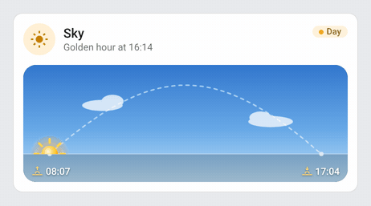 | 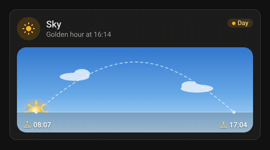 |

In the golden hour, the low orange sun close to the sunset and the warm glow of the horizon shimmering:

| Light | Dark |
|---|---|
| 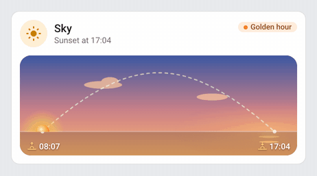 | 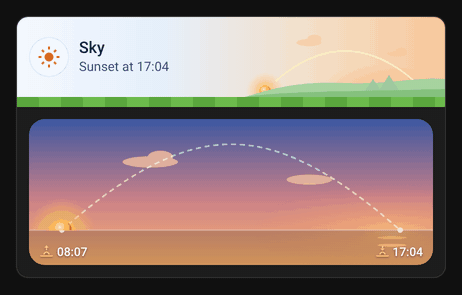 |

At night, the moon with its phase crossing the night arc from the sunset to the sunrise, twinkling stars and a shooting star:

| Dark | Light |
|---|---|
| 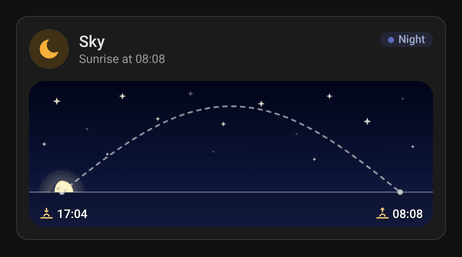 | 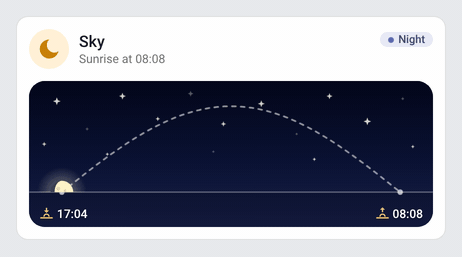 |

### Cards

The full card by day, in the golden hour and at night (Paris, 20 November 2026, a waxing gibbous moon four days before the full moon):

| | Day | Golden hour | Night |
|---|---|---|---|
| Light |  | 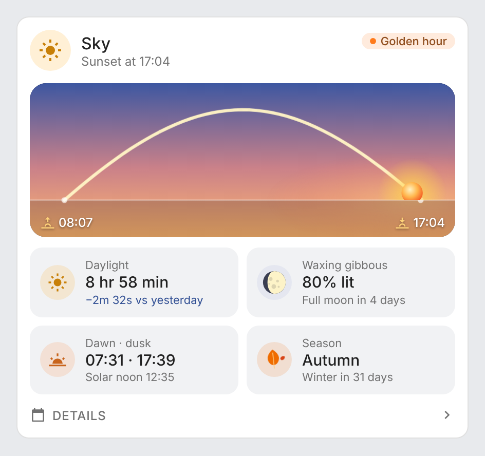 | 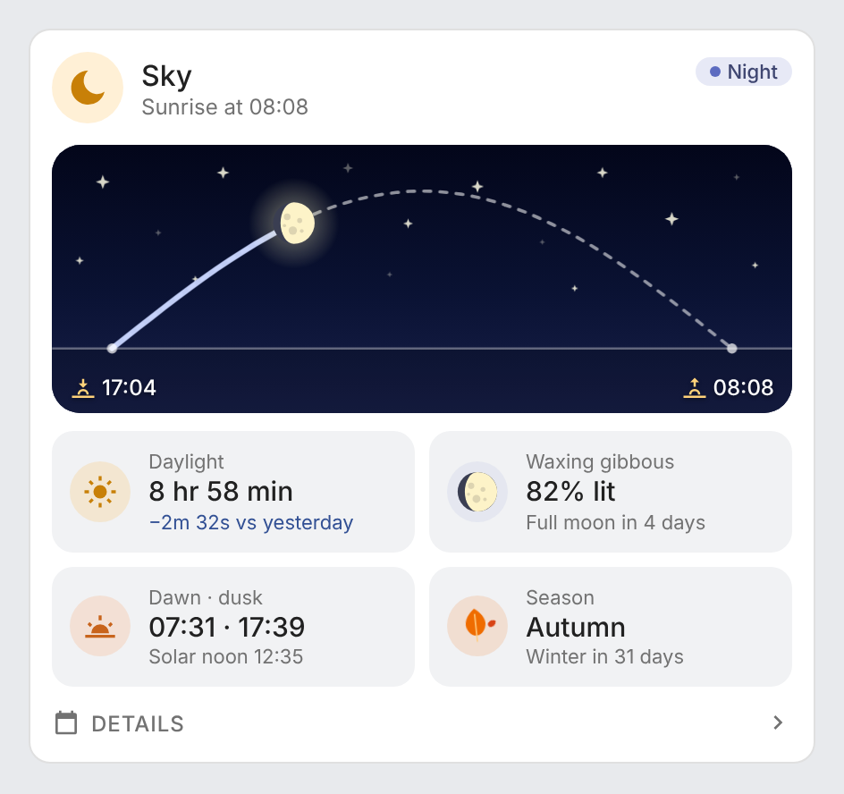 |
| Dark | 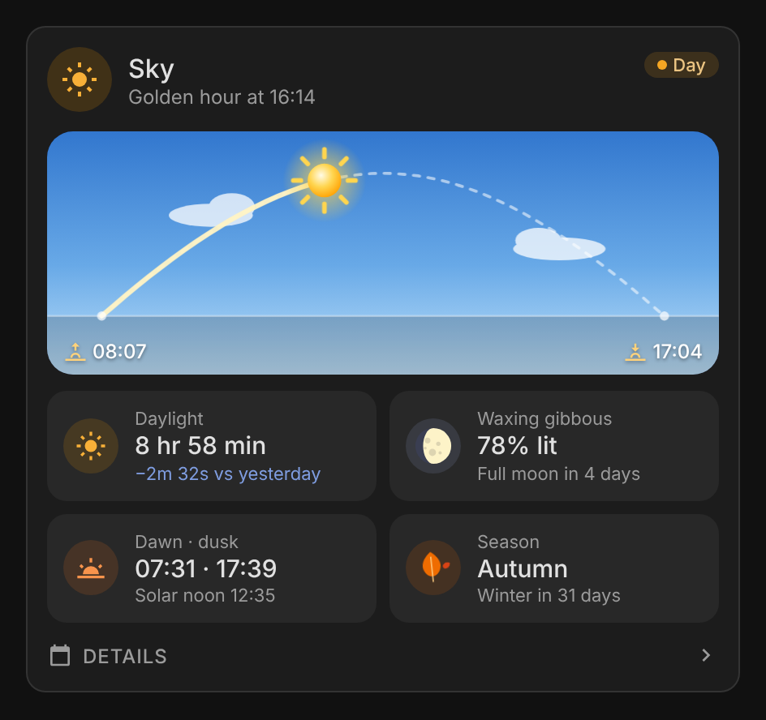 | 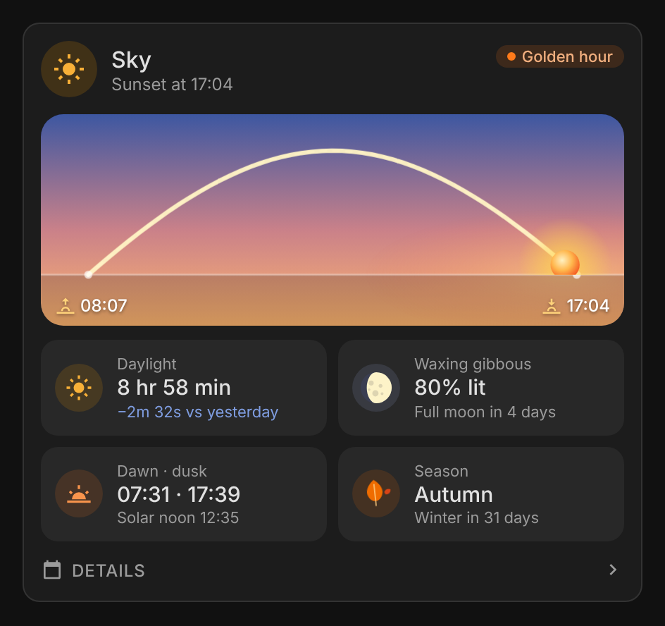 |  |

The details section unfolded:

| Light | Dark |
|---|---|
| 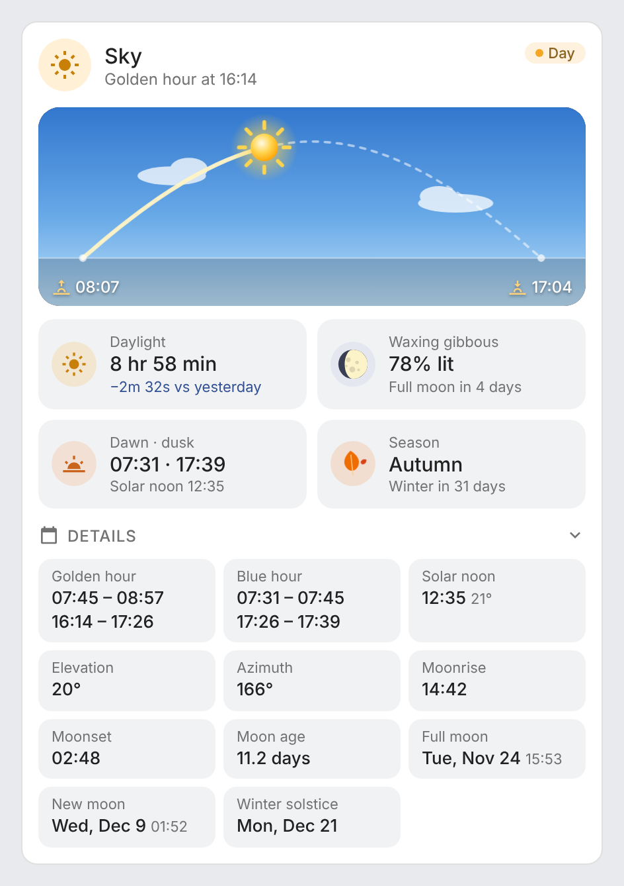 | 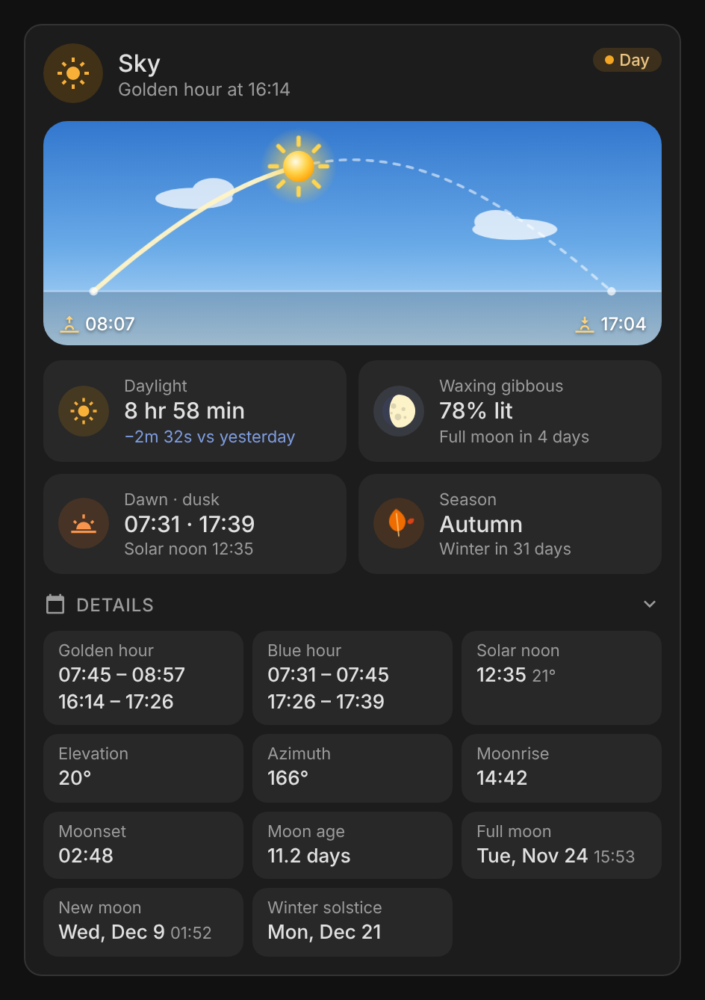 |

With the core integrations only (Sun, Moon, Season, no Lunar Phase): the moon's illumination and its next full moon are computed by the card (`details: hidden`):

| Dark | Light |
|---|---|
| 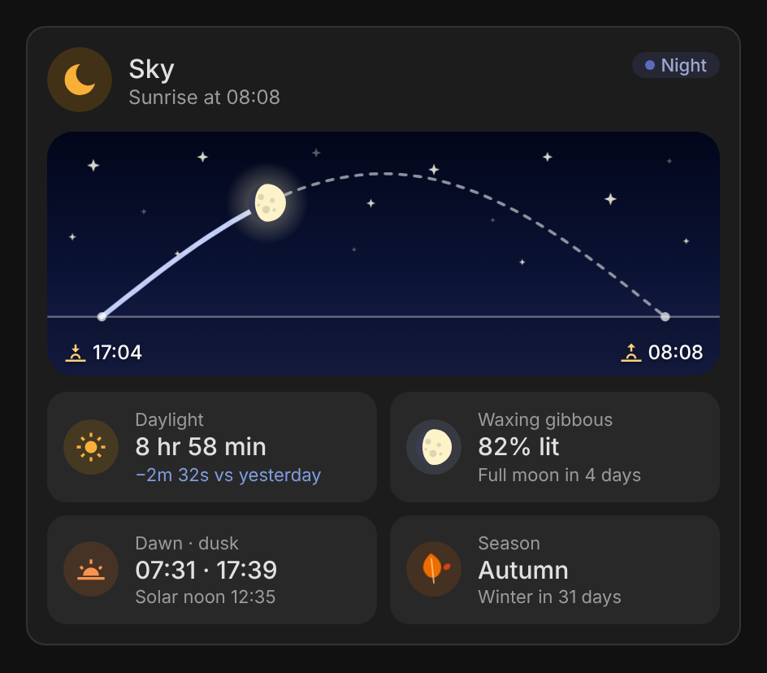 | 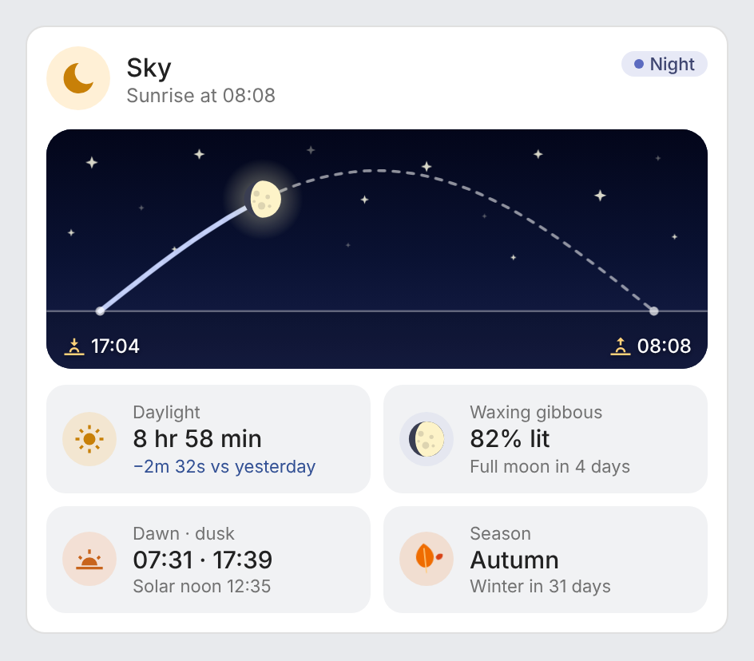 |

The mini card by day and at night (by night its strip runs from the sunset to the next sunrise), and its detailed view after a click on the detail button:

| | Day | Night |
|---|---|---|
| Light |  | 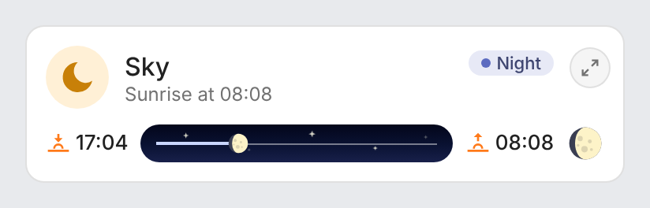 |
| Dark | 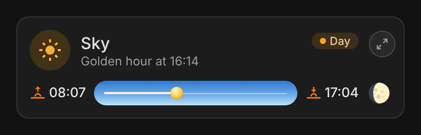 |  |

| Detail view, light | Detail view, dark |
|---|---|
| 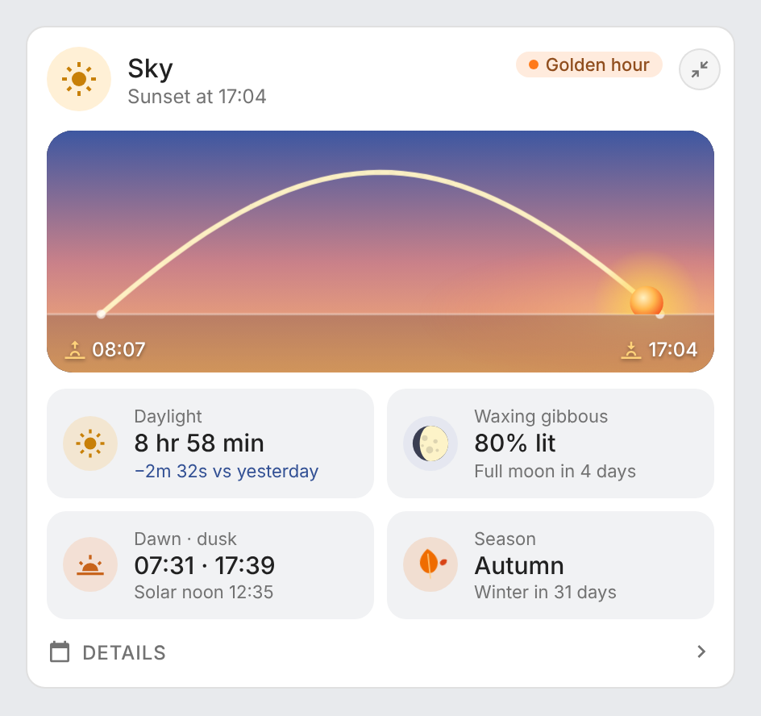 | 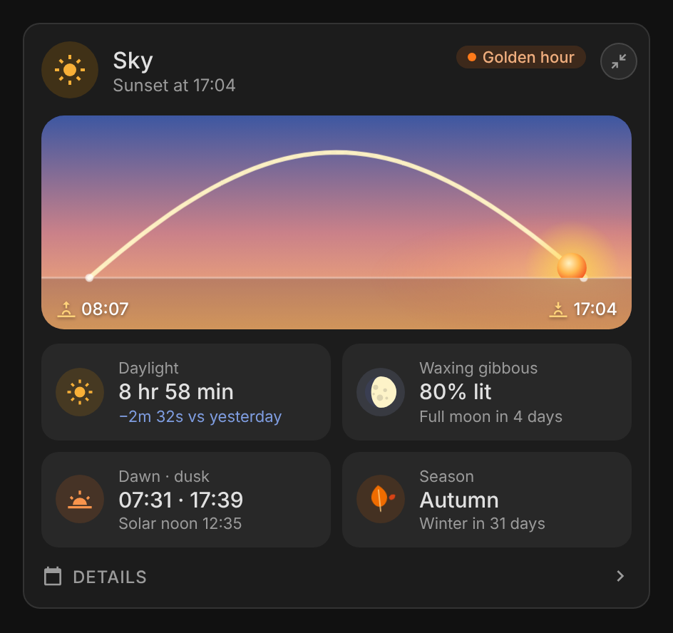 |

Narrow widths: the full card at 238 px (the tiles stack their icon above the text) and the mini card at 170 px (the pill keeps its dot, the sunrise and sunset icons give way):

| | Full card | Mini card |
|---|---|---|
| Light | 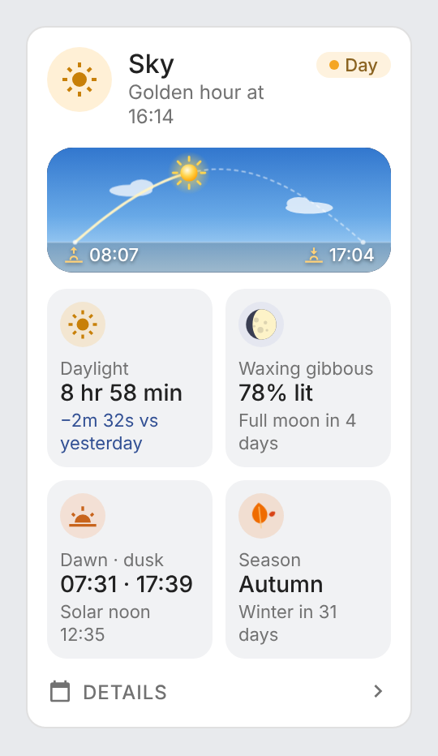 | 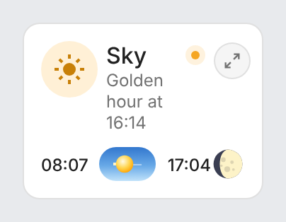 |
| Dark | 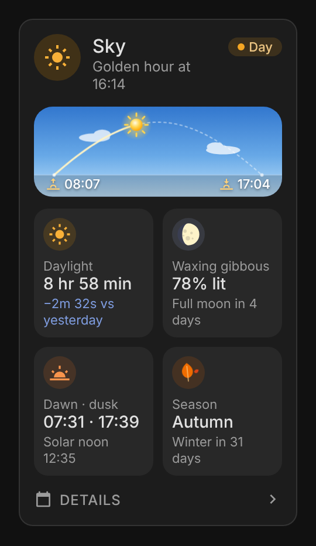 | 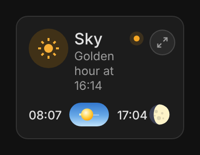 |

## How it works

The cards find their entities in the Home Assistant entity registry by integration (`sun`, `moon`, `season`, `lunar_phase`), whatever their entity ids or language, else under their usual ids (`sun.sun`, `sensor.moon_phase`, `sensor.season`). Lunar Phase sensors are matched by their translation key or the end of their entity id (`…_moon_rise`, `…_next_full_moon`…). The cards are redrawn every minute while they are on the page, and patched in place so that the animations go on.

### The light of the moment

From the sun's elevation (`sun.sun`, else computed): **Day** above 6°, **Golden hour** from 6° to −4°, **Blue hour** from −4° to −6° (the end of civil twilight), **Night** below. The sky band's colors are blended from the elevation, so they shift little by little through the day. The subtitle shows the first event to come among the evening golden hour, the sunset and the next sunrise.

### Computed by the card

Today's sun times come from `sun.sun`; with the home location the card also computes them for the whole day (golden and blue hours, yesterday's daylight for the change, yesterday's sunset and tomorrow's sunrise for the night arc) with NOAA's solar equations. Without Lunar Phase, the moon's illumination comes from the sun–moon elongation (main terms of Meeus' lunar theory, chapters 47–48), the next full and new moons from Meeus' phase series (chapter 49, within a few minutes), moonrise and moonset from the moon's altitude, and the phase name from the moon's age when there is no Moon sensor either. Without a Season sensor, the season comes from the solstices and equinoxes (Meeus, chapter 27) or the meteorological dates (`season_type`), swapped in the southern hemisphere, where the moon's lit side is mirrored too. The details section shows a hint (tooltip) when part of it is computed.

## Development

```bash
npm install
npm run build        # bundles src/sky-card.js into dist/sky-card.js (translations split into dist/sky-card.i18n.*.js)
npm run check        # builds and checks the card (run in CI)
npm test             # unit tests (node --test)
npm run screenshots  # renders the cards (and one GIF per animated state, needs ffmpeg) with mock data into screenshots/
```

`dist/` is not committed: `npm run build` creates it locally, CI builds it on every push, and the release workflow attaches the built files to the release, which is where the Marketplace installs it from. The **Screenshots** workflow re-renders the captures on every pull request that touches the card and commits them to the pull request's branch when a pixel changed.

### Releasing

1. Bump `version` in `package.json` (and `package-lock.json` with `npm install`)
2. Add a `## <version>` section at the top of [CHANGELOG.md](https://github.com/juju35/ha-sky-card/blob/main/CHANGELOG.md)
3. Push to `main`: the **Release** workflow builds the card, creates the tag and the GitHub release with the changelog section as notes, and attaches `sky-card.js` and its translation files

## Translations

The cards auto-detect the language from your Home Assistant settings. Currently supported:

| Language | Code |
|---|---|
| English | `en` |
| Français | `fr` |
| Deutsch | `de` |
| Español | `es` |
| Italiano | `it` |
| Nederlands | `nl` |
| Português (European; also used for `pt-BR`) | `pt` |
| Polski | `pl` |
| Српски | `sr` |
| Srpski (latinica) | `sr-Latn` |
| Română | `ro` |
| Dansk | `da` |
| Svenska | `sv` |
| Български | `bg` |
| Русский | `ru` |
| Українська | `uk` |
| Magyar | `hu` |
| Slovenčina | `sk` |
| Čeština | `cs` |
| Slovenščina | `sl` |
| Latviešu | `lv` |
| Ελληνικά | `el` |

Contributions for additional languages are welcome!

## Credits

Astronomical algorithms after Jean Meeus, *Astronomical Algorithms* (2nd edition), and NOAA's solar calculator. The Lunar Phase logo comes from the [Home Assistant brands](https://github.com/home-assistant/brands) repository. This project is not affiliated with the Lunar Phase project.

## License

[MIT](https://github.com/juju35/ha-sky-card/blob/main/LICENSE)

## Support

If you find this project useful, you can support its development:

<a href="https://buymeacoffee.com/julienstep9"></a>
